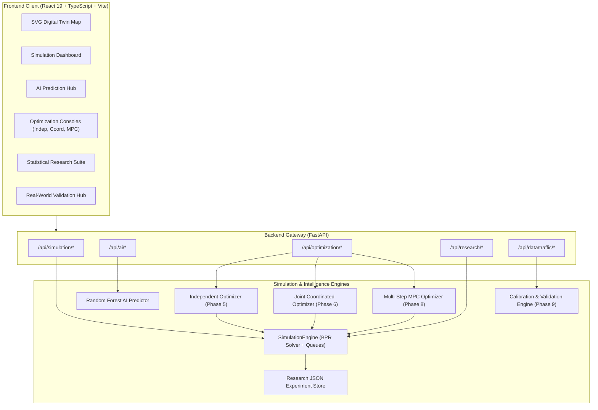

# Complete Academic Review and Technical Defense Guide: AI-Driven Twin Cities Optimization

**Project Title:** AI-Driven Twin Cities Optimization Using Digital Twins, Machine Learning, and Joint Coordinated Optimization  
**Date:** October 2026  
**Audience:** Academic Committee, Project Examiners, Technical Reviewers, and Developers  

---

## 1. Project Overview

**AI-Driven Twin Cities Optimization** is an integrated software platform and research testbed designed to study and optimize multi-jurisdictional urban transportation. The project models two adjacent, interconnected cities (**City A: Metro Alpha** and **City B: Metro Beta**) connected by a shared regional highway corridor (**Intercity Corridor**).

The platform models traffic dynamics using macroscopic Bureau of Public Roads (BPR) link delay functions, forecasts short-term congestion using machine learning (Random Forest regressor), and experimentally evaluates three distinct traffic control paradigms:
1. **Independent Optimization (Phase 5)**: Decentralized local decision-making where each city optimizes only its own roads without communicating.
2. **Joint Coordinated Optimization (Phase 6)**: Centralized optimization evaluating all 25 cross-city action combinations under shared corridor and budget constraints.
3. **Multi-Step Model Predictive Control (Phase 8)**: Forward-looking receding-horizon planning ($H=3$) utilizing Bounded Beam Search to evaluate multi-step action sequences under demand uncertainty.

The system includes a traffic-data layer (Phase 9) that validates and maps imported records and calibrates simulation parameters against a generated PeMS-schema-aligned synthetic benchmark (`DATASET-BENCHMARK-TC-01`). CSV/JSON imports are supported, but their source authenticity is not independently verified.

---

## 2. Problem Statement & Motivation

In modern urban regions, adjacent cities frequently share major highway links, freight bypasses, and commuter corridors. When municipalities operate isolated traffic management centers (TMCs):
- **Spillover Congestion**: Flushing queues from City A onto the intercity highway overloads City B's receiving arterials.
- **Myopic Decision-Making**: Single-step reactive signal adjustments fail to prevent cyclical shockwaves.
- **Coordination Vacuum**: No shared communication channel exists to trade off intervention costs or balance regional corridor capacity.

This project investigates whether joint coordination or multi-step predictive control delivers measurable, statistically validated benefits over traditional isolated municipal management.

---

## 3. Objectives and Scope

### Key Research Questions
1. **RQ1 (Coordination Advantage)**: Does joint coordinated optimization improve system-wide travel time and queue dissipation compared to independent municipal control?
2. **RQ2 (Multi-Step Planning Utility)**: Does receding-horizon Model Predictive Control (MPC) with lookahead $H=3$ reduce congestion compared to greedy single-step decision-making?
3. **RQ3 (Computational Trade-Off)**: What is the decision latency and evaluation overhead between decentralized ($\mathcal{O}(A_1+A_2)$), joint ($\mathcal{O}(A_1 \times A_2)$), and multi-step lookahead ($\mathcal{O}(K \cdot A_1 A_2)$) optimization?
4. **RQ4 (Benchmark Calibration)**: How does calibration change agreement between the BPR digital twin and the generated benchmark, and what additional evidence is needed for external validation?

### Scope and Boundaries
- Modeled network: 20 road links (10 in City A, 10 in City B), 10 intersections, and 1 shared intercity corridor.
- 5 discrete traffic control actions per municipality (total $5 \times 5 = 25$ joint action pairs).
- Macroscopic traffic modeling (BPR link volume-delay curves and spillover queues) rather than microscopic sub-second car-following.

---

## 4. Architecture & Workflow Diagrams

### High-Level System Architecture


### Operational Execution Cycle
```mermaid
sequenceDiagram
    autonumber
    participant UI as Dashboard UI
    participant Backend as FastAPI Server
    participant Engine as Simulation Engine
    participant ML as Random Forest Model
    participant Opt as Optimizer (Indep / Coord / MPC)

    UI->>Backend: Request Step / Action Selection
    Backend->>Engine: Retrieve Current Step Telemetry
    Engine->>ML: Pass Current Volume, Speed, and Feeder State
    ML-->>Opt: Provide Predicted Conditions (t+1, t+3)
    Opt->>Engine: Evaluate Candidate Actions on Sandboxed Clones (copy.deepcopy)
    Opt->>Backend: Return Recommended Action(s) & Expected Cost
    Backend->>Engine: Apply Committed Action to Live Digital Twin
    Engine->>Engine: Solve BPR Delays, Queues & Spillover
    Engine-->>Backend: Return Updated State
    Backend-->>UI: Stream Live SVG Congestion Colors & Telemetry
```

---

## 5. Technology Stack & Design Decisions

| Component | Technology | Rationale |
|---|---|---|
| **Backend Framework** | **FastAPI (Python 3.12)** | Asynchronous, high-throughput, native Pydantic data validation, automatic OpenAPI documentation. |
| **Scientific Computing** | **NumPy & Scipy** | Fast vector operations, descriptive statistics, Student's t-tests, and Wilcoxon signed-rank evaluations. |
| **Machine Learning** | **Scikit-Learn** | Robust, deterministic Random Forest regression with multi-output support and persistent serialization. |
| **Simulation Solver** | **Pure Python Class (`SimulationEngine`)** | Lightweight, zero-dependency, deterministic BPR solver allowing rapid cloning (`copy.deepcopy`) for sandbox branching. |
| **Frontend Framework** | **React 19 + TypeScript** | Strict typing, component modularity, reactive state updates, and robust interactive controls. |
| **Build Tool** | **Vite v8** | Instant Hot Module Replacement (HMR), lightweight development server, fast production bundling. |
| **Visualizations** | **Recharts & Lucide React** | Responsive SVG charts (line, bar, scatter) and modern cyber-dark design iconography. |

---

## 6. Folder Structure & Source-File Guide

```
Ai twin cities/
├── backend/
│   ├── app/
│   │   ├── api/
│   │   │   ├── simulation.py      # /api/simulation endpoints (state, step, reset, scenario)
│   │   │   ├── ai.py              # /api/ai endpoints (train, predict, status, evaluation)
│   │   │   ├── optimization.py    # /api/optimization endpoints (indep, coord, mpc, scenarios)
│   │   │   ├── research.py        # /api/research endpoints (run, results, statistics, export)
│   │   │   └── realworld.py       # /api/data/traffic endpoints (sources, datasets, calibrate, validate)
│   │   ├── models/
│   │   │   ├── simulation_models.py
│   │   │   ├── ai_models.py
│   │   │   ├── optimization_models.py
│   │   │   ├── coordinated_optimization_models.py
│   │   │   ├── mpc_models.py
│   │   │   ├── research_models.py
│   │   │   └── realworld_models.py
│   │   ├── services/
│   │   │   ├── simulation_engine.py          # BPR equations, network topology, queue logic
│   │   │   ├── ai_predictor.py               # Random Forest multi-horizon forecasting
│   │   │   ├── independent_optimizer.py       # Phase 5 decentralized municipal optimizer
│   │   │   ├── coordinated_optimizer.py       # Phase 6 centralized 25-pair optimizer
│   │   │   ├── mpc_optimizer.py               # Phase 8 receding-horizon MPC with beam search
│   │   │   ├── research_experiment_runner.py  # Phase 7 multi-seed matched experimental runner
│   │   │   ├── statistical_evaluator.py       # Paired t-tests, Wilcoxon, Cohen's dz, Holm-Bonferroni
│   │   │   ├── realworld_service.py           # Phase 9 CSV/JSON ingestion, quarantine, PeMS data
│   │   │   └── calibration_service.py         # Phase 9 bounded parameter calibration & safe metrics
│   │   └── main.py              # FastAPI server entry point, CORS, and health endpoints
│   ├── data/research_experiments/ # Persisted JSON experiment records (EXP-*.json)
│   ├── tests/                   # 57 unit and integration tests across all phases
│   ├── requirements.txt         # Python package dependencies
│   └── main.py                  # Uvicorn executable script
├── frontend/
│   ├── src/
│   │   ├── components/
│   │   │   ├── digitaltwin/     # TwinCitiesMap.tsx, RoadDetailsPanel.tsx, CityMetricsPanel.tsx
│   │   │   ├── optimization/    # Independent, Coordinated, and MPC planning pages
│   │   │   ├── research/        # ResearchEvaluationPage.tsx (statistics & charts)
│   │   │   ├── realworld/       # RealWorldValidationPage.tsx (ingestion & calibration)
│   │   │   ├── SimulationPage.tsx
│   │   │   └── AIPredictionsPage.tsx
│   │   ├── services/api.ts      # TypeScript interfaces and REST API client
│   │   ├── App.tsx              # Application layout, navigation tabs, and status banners
│   │   └── index.css            # Cyber-dark design system tokens
│   ├── package.json
│   └── vite.config.ts           # Reverse proxy configuration (/api -> :8000)
├── docs/
│   ├── FINAL_RESEARCH_REPORT.md      # 19-section academic research paper
│   └── ARCHITECTURE_AND_WORKFLOWS.md # Mermaid architecture and workflow diagrams
├── PROJECT_EXECUTION_GUIDE.md        # Concise startup and viva demonstration steps
├── .env.example                      # Production-ready configuration template
├── .gitignore                        # Standard exclusions
└── README.md                         # Project documentation and API inventory
```

---

## 7. End-to-End Execution Trace

To understand how the frontend and backend communicate, trace a real user request: **Advancing the simulation by one step with an action applied**.

1. **Frontend Action**: In `SimulationPage.tsx`, the user clicks the "Step Simulation" button.
2. **API Call**: The client invokes `stepSimulation({ steps_to_advance: 1 })` in `api.ts`, which sends an HTTP `POST` request to `http://localhost:5173/api/simulation/step`.
3. **Vite Proxy**: Vite routes the request to `http://127.0.0.1:8000/api/simulation/step`.
4. **Backend Route Handler**: `step_simulation(payload)` in `backend/app/api/simulation.py` receives the request.
5. **Service Execution**: The handler calls `sim_engine.advance_step(steps=1)` in `simulation_engine.py`.
6. **Physical Simulation Update**:
   - Updates sinusoidal diurnal demand $D(t)$.
   - Computes vehicular flow on all 20 roads.
   - Computes travel time using the BPR formula: $t_e = t_0 \cdot [1 + 0.15 \cdot (V_e / C_e)^4]$.
   - Accumulates queues where volume exceeds capacity ($V_e > C_e$).
   - Computes bottleneck queue on `IC_CORRIDOR`.
7. **Response Serialization**: Returns a Pydantic `SimulationStateResponse` with link speeds, queue lengths, and congestion percentages.
8. **Frontend State Update**: React state `simState` is updated; the SVG map recolors road links according to their BPR congestion band (`Low`: green, `Medium`: yellow, `High`: orange, `Severe`: red).

---

## 8. Digital Twins & Simulation Mechanics

### What is a "Digital Twin" in This Project?
A software representation of two physical metropolitan traffic networks that maintains real-time state, simulates physical road constraints, evaluates hypothetical control policies in memory-isolated sandboxes, and ingests external sensor observations for parameter calibration.

### Network Topology
- **City A (Metro Alpha)**: 10 road links ($A_1 \dots A_{10}$), 5 nodal intersections, concentric commuter network feeding outward to the highway.
- **City B (Metro Beta)**: 10 road links ($B_1 \dots B_{10}$), 5 nodal intersections, circumferential industrial bypass network.
- **Intercity Corridor (`IC_CORRIDOR`)**: 15 km connecting highway with base capacity of 1,800 veh/h (throttled to 900 veh/h during bottleneck scenarios).

### Core Mathematical Equations

#### 1. Bureau of Public Roads (BPR) Link Delay Equation
$$t_e = t_0 \cdot \left[1.0 + \alpha \cdot \left(\frac{V_e}{C_e}\right)^\beta\right]$$
- $t_e$: Link travel time (minutes).
- $t_0$: Free-flow travel time = $(\text{Length} / \text{Free Speed}) \times 60$.
- $V_e$: Current vehicle flow volume on link $e$ (veh/h).
- $C_e$: Maximum link throughput capacity (veh/h).
- $\alpha = 0.15$: Standard BPR congestion onset coefficient.
- $\beta = 4.0$: Standard BPR exponential penalty exponent.

#### 2. Bottleneck Queue Accumulation Equation
$$Q_e(t) = \max\left(0.0, \; Q_e(t-1) + \left[V_e(t) - C_e(t)\right] \cdot \Delta t\right)$$
- If volume exceeds capacity ($V_e > C_e$), excess vehicles spill over into the intersection queue.
- If capacity exceeds volume ($C_e > V_e$), queued vehicles dissipate.

#### 3. Sinusoidal Diurnal Demand Curve
$$D(t) = D_{\text{base}} \cdot \left[1.0 + 0.35 \cdot \sin\left(\frac{2\pi t}{24} - \frac{\pi}{2}\right)\right] + \epsilon_t, \quad \epsilon_t \sim \mathcal{N}(0, \sigma^2)$$

---

## 9. Machine Learning Prediction Engine (Phase 4)

### Purpose
Forecasts future traffic volume and congestion levels $h$ steps ahead ($h \in \{1, 3, 6\}$) so optimizers can make proactive, rather than purely reactive, decisions.

### Architecture
- **Model Type**: Multi-Output Random Forest Regressor (`n_estimators=45, max_depth=9, min_samples_split=3, random_state=42`).
- **Input Features (19 features)**:
  `[time_sin, time_cos, demand_a, congestion_a, travel_time_a, active_a, queue_a, demand_b, congestion_b, travel_time_b, active_b, queue_b, ic_volume, ic_congestion, demand_level_code, demand_a_lag1, congestion_a_lag1, demand_b_lag1, congestion_b_lag1]`
- **Target Outputs (4 continuous targets)**:
  `[city_a_demand, city_a_congestion, city_b_demand, city_b_congestion]`

### Dataset & Prevention of Data Leakage
- **Dataset Size**: 798 samples generated from synthetic simulation trajectories (570 training samples, 228 test samples).
- **Split Method**: Held-out-seed split: training uses seeds `[100, 107, 114, 121, 128]`; testing uses disjoint seeds `[901, 902]`. This is not a chronological time split. Test results measure generalization across generated seed trajectories, not across future timestamps or physical cities.
- **Persistence Baseline**: The standard transportation benchmark where future traffic is predicted to be equal to current traffic: $\hat{y}_{t+h} = y_t$.

### Measured Performance (Unseen Test Data)

| Predicted Variable | Random Forest MAE | Persistence Baseline MAE | Error Reduction (%) |
|---|---|---|---|
| **City A Traffic Demand** | **25.13 veh/step** | 206.61 veh/step | **87.8%** |
| **City A Congestion** | **1.04%** | 8.83% | **88.2%** |
| **City B Traffic Demand** | **20.02 veh/step** | 166.53 veh/step | **88.0%** |
| **City B Congestion** | **1.44%** | 10.69% | **86.5%** |

---

## 10. Optimization Paradigms: Independent vs. Joint Coordinated

### Available Discrete Actions (5 Actions per City)
1. `MAINTAIN_CURRENT`: Baseline default operations (Cost: $0).
2. `SIGNAL_SPLIT_OPTIMIZATION`: Increases arterial throughput by 15% (Cost: $20).
3. `PERIMETER_METERING`: Restricts vehicle intake by 15% to protect internal network (Cost: $35).
4. `DYNAMIC_SPEED_HARMONIZATION`: Reduces speed by 10% to smooth flow and reduce shockwaves (Cost: $15).
5. `REVERSIBLE_LANE_REALLOCATION`: Increases peak direction capacity by 30%, reduces opposing capacity by 30% (Cost: $50).

### Independent Optimization (Phase 5)
- **Decentralized Control**: City A and City B optimize separately.
- **Information Boundary**: City A has zero access to City B's road loads, queues, or objective function.
- **Objective Function**:
  $$\min_{a \in \mathcal{A}} c_{\text{local}} = 0.35 \left(\frac{T}{30}\right) + 0.35 \left(\frac{\text{Cong}}{100}\right) + 0.15 \left(\frac{Q}{500}\right) + 0.15 \left(\frac{\text{Cost}}{60}\right)$$
- **Operational Flaw**: When City A flushes local queues to minimize its own cost, it overloads the shared intercity highway, pushing congestion onto City B.

### Joint Coordinated Optimization (Phase 6)
- **Centralized Control**: Evaluates all $5 \times 5 = 25$ candidate action combinations $(a_A, a_B)$.
- **Combined System Objective**:
  $$\min_{(a_A, a_B)} c_{\text{sys}} = 0.30 \left(\frac{T_{\text{sys}}}{30}\right) + 0.30 \left(\frac{\text{Cong}_{\text{sys}}}{100}\right) + 0.15 \left(\frac{Q_{\text{sys}}}{500}\right) + 0.15 \left(\frac{T_{\text{ic}}}{35}\right) + 0.10 \left(\frac{\text{Cost}_{\text{tot}}}{120}\right)$$
- **Constraints Enforced**:
  - Combined municipal budget: $\text{Cost}(a_A) + \text{Cost}(a_B) \le 120.0$.
  - Shared corridor capacity limit: $\text{Flow}_{\text{in}}(\text{IC\_CORRIDOR}) \le \text{Capacity}(\text{IC\_CORRIDOR})$.

---

## 11. Advanced Optimization: Multi-Step MPC (Phase 8)

### Receding Horizon Formulation
Plans actions across a forward lookahead horizon $H \in \{1, 2, 3, 5\}$ by minimizing discounted cumulative cost:
$$C = \sum_{t=0}^{H-1} \gamma^t c_{\text{system}}(t), \quad \gamma = 0.95$$

### Bounded Beam Search Algorithm
An unrestricted forward tree over $H=3$ steps produces $25^3 = 15,625$ candidate trajectories, causing unacceptable computation delays. Phase 8 implements **Bounded Beam Search**:
1. At $t=0$, evaluate all 25 joint action pairs on isolated sandbox copies (`copy.deepcopy`).
2. Rank candidates by cumulative cost and retain the top $K$ branches (default beam width $K=5$).
3. At steps $t=1 \dots H-1$, expand only retained branches until `max_search_budget` is reached (default 200, configurable up to 500). Robust/risk-sensitive scenario replays add work outside that nominal counter.
4. Commit **only the immediate action pair** $(a_A^0, a_B^0)$ to the live simulation engine, advance the state, and re-plan at the next step.

---

## 12. Synthetic Simulation Results (10-Seed Matched Experiment)

### Experiment Configuration
- **Experiment ID**: `EXP-B1F1EEB4`
- **Sample Size**: $N = 10$ matched random seeds (Seeds 42 through 51).
- **Duration**: 12 simulation steps per run.
- **Strategies Compared**: (1) Unoptimized Baseline, (2) Phase 5 Independent, (3) Phase 6 Coordinated, (4) Phase 8 Multi-Step MPC.

### Stored Simulation Metrics Across Scenarios

#### Peak Demand Scenario (High Stress)
- **Unoptimized Baseline**: Travel Time: $9.20 \pm 0.14$ min, Congestion: $96.5 \pm 0.5\%$, Queue: $2,227.3 \pm 140.4$ veh, Cost: $1.161 \pm 0.044$.
- **Independent Optimization**: Travel Time: $7.97 \pm 0.08$ min (**-13.4%**), Congestion: $88.9 \pm 0.9\%$, Queue: $724.2 \pm 81.1$ veh (**-67.5%**), Cost: $0.744 \pm 0.026$. Runtime: **8.3 ms/run**.
- **Coordinated Optimization**: Travel Time: $7.99 \pm 0.09$ min (**-13.2%**), Congestion: $93.0 \pm 0.8\%$, Queue: $781.2 \pm 93.6$ veh (**-64.9%**), Cost: $0.757 \pm 0.030$. Runtime: **538.2 ms/run**.
- **Multi-Step MPC ($H=3$)**: Travel Time: $8.09 \pm 0.08$ min (**-12.1%**), Congestion: $93.8 \pm 0.7\%$, Queue: $868.4 \pm 82.0$ veh (**-61.0%**), Cost: $1.324 \pm 0.042$. Runtime: **3,551.0 ms/run**.

#### Normal Demand Scenario (Baseline Diurnal)
- **Unoptimized Baseline**: Travel Time: $7.39 \pm 0.02$ min, Congestion: $76.5 \pm 0.8\%$, Queue: $185.4 \pm 14.0$ veh, Cost: $0.445 \pm 0.006$.
- **Independent Optimization**: Travel Time: $7.21 \pm 0.02$ min, Congestion: $68.5 \pm 0.6\%$, Queue: $51.2 \pm 6.8$ veh, Cost: $0.427 \pm 0.004$.
- **Coordinated Optimization**: Travel Time: $7.21 \pm 0.02$ min, Congestion: $75.1 \pm 0.7\%$, Queue: **$43.6 \pm 3.6$ veh** (**-13.91% pairwise reduction vs Independent**).
    - *Inferential Statistics*: Raw paired t-test $t(9) = 4.0737, p_{\text{raw}} = 0.0027842$; Wilcoxon $W = 3.0, p = 0.0039063$; 95% CI $[3.4023, 11.8997]$ vehicles; Cohen's $d_z = 1.2882$. Holm adjusted $p_{\text{adj}} = 0.0160021$ within the 15 testable normal-scenario metric hypotheses (16 metrics total; one has zero-variance differences).
- **Multi-Step MPC ($H=3$)**: Travel Time: $7.30 \pm 0.02$ min, Congestion: $75.0 \pm 0.8\%$, Queue: $116.7 \pm 6.2$ veh, Cost: $0.595 \pm 0.014$. Runtime: $3,458.2 \pm 238.0$ ms/run.

#### Intercity Bottleneck Scenario (Corridor Throttled to 900 veh/h)
- **Unoptimized Baseline**: Travel Time: $7.19 \pm 0.03$ min, Congestion: $74.9 \pm 0.9\%$, Queue: $60.5 \pm 15.4$ veh, Cost: $0.384 \pm 0.007$.
- **Independent Optimization**: Travel Time: $6.97 \pm 0.01$ min, Congestion: $65.6 \pm 0.6\%$, Queue: $0.0 \pm 0.1$ veh, Cost: $0.389 \pm 0.003$.
- **Coordinated Optimization**: Travel Time: $7.10 \pm 0.02$ min, Congestion: $73.4 \pm 0.8\%$, Queue: $2.2 \pm 1.4$ veh, Cost: **$0.369 \pm 0.004$** (Lowest combined cost).
- **Multi-Step MPC ($H=3$)**: Travel Time: $7.11 \pm 0.02$ min, Congestion: $73.8 \pm 0.9\%$, Queue: $4.8 \pm 3.2$ veh, Cost: $0.436 \pm 0.011$.

---

## 13. Traffic Data Ingestion & Synthetic Benchmark Calibration (Phase 9)

### Dataset Provenance
- **Dataset ID**: `DATASET-BENCHMARK-TC-01`
- **Origin & Nature**: Formula-generated synthetic benchmark aligned to a PeMS-like schema. It is not Caltrans data or external sensor telemetry; generated records are tagged `SIMULATED`.
- **Data Schema**: Aligned with California Department of Transportation (Caltrans) PeMS detector schema: station/sensor ID, UTC timestamp, vehicular flow count, average speed (km/h), occupancy percentage, and travel time.
- **External Data Ingestion**: CSV/JSON upload and import are supported, but the application does not authenticate or independently verify their source.
- **Record Count**: 288 generated records: 48 hourly intervals at each of 6 locations (`SENSOR_ALPHA_NORTH`, `SENSOR_ALPHA_CORE`, `SENSOR_ALPHA_PORT`, `SENSOR_BETA_CAMPUS`, `SENSOR_BETA_CORE`, `SENSOR_IC_CORRIDOR`).

### Calibration Methodology
- **Parameters Adjusted**: `demand_scale` $\in [0.5, 2.0]$, `capacity_scale` $\in [0.7, 1.5]$, `speed_factor` $\in [0.8, 1.2]$, `intercity_capacity_scale` $\in [0.5, 1.8]$.
- **Chronological Holdout Split**: Records are sorted by timestamp; the first 70% (201 records) are used for calibration search and the remaining 30% (87 records) for validation. This is performed on generated benchmark records and is not evidence of generalization to real traffic.
- **Safe Error Metrics**:
  - Safe MAPE protects against division by zero using $\epsilon = 0.5$:
    $$\text{Safe MAPE} = \frac{100\%}{N} \sum_{i=1}^N \frac{|y_i - \hat{y}_i|}{\max(|y_i|, 0.5)}$$
  - Pearson correlation $r$ safely handles zero variance ($\sigma < 10^{-6} \implies r = 0.0$).

### Calibration Result Scope
Calibration scores compare the simulation with the selected dataset. For the built-in dataset, both sides are generated synthetically. Do not describe these scores as real-world validation; report a calibration percentage only alongside a reproducible result from the current code and its dataset provenance.
- **Mean Signed Bias**: -0.276 min (uncalibrated: -0.481 min, **42.6% reduction in bias**).
- **Pearson Correlation ($r$)**: **0.979** between calibrated simulation output and the generated synthetic benchmark across 87 holdout records; this is not external-data validation.

---

## 14. API Endpoint Reference (Generated from Registered Routes)

| Method | Endpoint Path | Function in Code | Expected Payload / Parameters |
|---|---|---|---|
| `GET` | `/api/health` | `health_check()` | None |
| `GET` | `/api/system/status` | `system_status()` | None |
| `GET` | `/api/simulation/state` | `get_simulation_state()` | None |
| `POST` | `/api/simulation/initialize` | `initialize_simulation()` | `{ seed?: int, demand_level?: str, intercity_capacity?: int }` |
| `POST` | `/api/simulation/step` | `step_simulation()` | `{ steps_to_advance?: int }` |
| `POST` | `/api/simulation/reset` | `reset_simulation()` | None |
| `POST` | `/api/simulation/scenario` | `generate_scenario()` | `{ scenario_id: str }` |
| `GET` | `/api/simulation/metrics` | `get_simulation_metrics()` | None |
| `POST` | `/api/ai/train` | `train_model()` | None |
| `GET` | `/api/ai/status` | `get_model_status()` | None |
| `POST` | `/api/ai/predict` | `predict_traffic()` | `{ horizon: int }` |
| `GET` | `/api/ai/evaluation` | `get_evaluation()` | None |
| `GET` | `/api/ai/history` | `get_prediction_history()` | None |
| `POST` | `/api/optimization/independent/run` | `run_independent_optimization()` | `IndependentRunRequest` |
| `GET` | `/api/optimization/independent/status` | `get_independent_status()` | None |
| `GET` | `/api/optimization/independent/results`| `get_independent_results()` | None |
| `GET` | `/api/optimization/independent/actions`| `get_optimization_actions()` | None |
| `POST` | `/api/optimization/coordinated/run` | `run_coordinated_optimization()` | `CoordinatedRunRequest` |
| `GET` | `/api/optimization/coordinated/status`| `get_coordinated_status()` | None |
| `GET` | `/api/optimization/coordinated/results`| `get_coordinated_results()` | None |
| `GET` | `/api/optimization/compare` | `compare_strategies()` | `seed: int, demand_level: str, steps: int` |
| `GET` | `/api/optimization/mpc/config` | `get_mpc_config()` | None |
| `POST` | `/api/optimization/mpc/run` | `run_mpc_optimization()` | `MPCRunRequest` |
| `GET` | `/api/optimization/mpc/status` | `get_mpc_status()` | None |
| `GET` | `/api/optimization/mpc/results` | `get_mpc_results()` | None |
| `POST` | `/api/optimization/scenarios/run` | `run_scenario_planning()` | `seed: int, horizon: int, discount_factor: float` |
| `GET` | `/api/optimization/scenarios/results`| `get_scenario_planning_results()`| None |
| `POST` | `/api/research/experiments/run` | `run_research_experiment()` | `ExperimentConfigRequest` |
| `GET` | `/api/research/experiments/status/{id}`| `get_experiment_status()` | `experiment_id: str` |
| `GET` | `/api/research/experiments/{id}/results`| `get_experiment_results()` | `experiment_id: str` |
| `GET` | `/api/research/experiments/{id}/statistics`| `get_experiment_statistics()` | `experiment_id: str` |
| `GET` | `/api/research/experiments/history` | `get_experiment_history()` | None |
| `GET` | `/api/research/experiments/{id}/export`| `export_experiment_data()` | `experiment_id: str, format: 'json' \| 'csv'` |
| `GET` | `/api/data/traffic/sources` | `get_traffic_sources()` | None |
| `GET` | `/api/data/traffic/datasets` | `list_datasets()` | None |
| `GET` | `/api/data/traffic/datasets/{id}` | `get_dataset_metadata()` | `dataset_id: str` |
| `GET` | `/api/data/traffic/datasets/{id}/quality`| `get_dataset_quality_report()`| `dataset_id: str` |
| `GET` | `/api/data/traffic/datasets/{id}/export` | `export_dataset_records()` | `dataset_id: str, format: 'json' \| 'csv'` |
| `POST` | `/api/data/traffic/upload` | `upload_traffic_file()` | Multipart form `file, dataset_name, source_name` |
| `POST` | `/api/data/traffic/import` | `import_traffic_json()` | `ImportJsonRequest` |
| `POST` | `/api/data/traffic/datasets/{id}/mappings`| `update_dataset_mappings()` | `List[NetworkRoadMapping]` |
| `POST` | `/api/data/traffic/calibrate` | `calibrate_digital_twin()` | `CalibrationRequest` |
| `POST` | `/api/data/traffic/validate` | `validate_digital_twin()` | `ValidationRequest` |

---

## 15. Installation and Execution Instructions

### Setup Backend
```bash
cd backend
python -m pip install -r requirements.txt
python main.py
```
Backend runs at `http://127.0.0.1:8000`.

### Setup Frontend
```bash
cd frontend
npm install
npm run dev
```
Frontend runs at `http://localhost:5173`.

---

## 16. Test Commands & Outcomes

### Automated Unit and Integration Tests
```bash
cd backend
python -m pytest -v
```
**Outcome**: **57 passed, 0 failed in 18.66 seconds**.
- `test_simulation.py`: 8 tests passed.
- `test_ai_predictor.py`: 4 tests passed.
- `test_independent_optimization.py`: 9 tests passed.
- `test_coordinated_optimization.py`: 11 tests passed.
- `test_research_evaluation.py`: 6 tests passed.
- `test_mpc_optimization.py`: 9 tests passed.
- `test_realworld_validation.py`: 10 tests passed.

### Frontend Production Build
```bash
cd frontend
npm run build
```
**Outcome**: Clean build in 722 ms, 0 compilation or type errors.

---

## 17. Common Errors & Troubleshooting

1. **`ModuleNotFoundError: No module named 'app'`**:
   - Cause: Running `pytest` instead of `python -m pytest`.
   - Fix: Always execute `python -m pytest` from the `backend/` directory so Python adds the current directory to `sys.path`.
2. **`Dataset 'pems_dual_metro_benchmark' not found`**:
   - Cause: Using an incorrect dataset ID.
   - Fix: Use the canonical benchmark dataset ID `DATASET-BENCHMARK-TC-01`.
3. **CORS Connection Refused in Browser**:
   - Cause: Backend is not running or running on an unexpected port.
   - Fix: Confirm `uvicorn` is active on `http://127.0.0.1:8000` and check `/api/health`.

---

## 18. Known Limitations & Future Work

1. **Macroscopic Model**: The simulation uses the static BPR volume-delay equation. It does not model microscopic vehicle car-following (e.g., Intelligent Driver Model) or lane changes.
2. **Discrete Control Actions**: Traffic interventions are modeled as discrete steps (e.g., Signal Split +15%) rather than continuous split seconds.
3. **No Verified External Data**: The built-in calibration benchmark is synthetic and no independently verified external traffic observations are included. Simulation optimization outcomes do not establish real-world causal intervention effects.

---

## 19. Simple English Technical Glossary

- **Digital Twin**: A virtual model of a physical system that mirrors its real-world behavior and can test hypothetical actions in a sandbox before executing them in reality.
- **BPR Delay Function**: A formula developed by the Bureau of Public Roads that calculates how much slower cars travel as a road gets more crowded.
- **Capacity**: The maximum number of vehicles a road can process per hour under free-flowing conditions.
- **Spillover Queue**: Vehicles forced to stop and wait when traffic demand exceeds the road's exit capacity.
- **Decentralized Optimization**: When individual cities make decisions based purely on their own local information, without talking to neighboring cities.
- **Coordinated Optimization**: When two cities share information and pick a joint pair of actions that minimizes total regional delay.
- **Model Predictive Control (MPC)**: A method that plans multiple steps into the future, but only executes the very next step, checking the new state before planning again.
- **Receding Horizon**: Advancing the planning window forward by one step after each decision.
- **Bounded Beam Search**: A smart search method that explores only the top $K$ most promising action paths, throwing away bad options to save computation time.
- **Safe MAPE**: A percentage error formula with a small guard value ($\epsilon = 0.5$) in the denominator to prevent division by zero when traffic volume is zero.
- **Cohen's $d_z$**: A statistical number that measures how big the real difference between two strategies is, independent of sample size.

---

## 20. 30 Comprehensive Viva / Academic Defense Questions & Answers

### System Architecture & Digital Twin Concept
1. **Q: What exactly is a "digital twin" in the context of this project?**  
   **A:** A digital twin is a software representation of City A, City B, and their shared highway link that mirrors physical road geometry, traffic flow, and queue dynamics. It allows us to clone current states (`copy.deepcopy`), test hypothetical traffic control interventions in memory sandboxes, and observe their impacts before committing them.

2. **Q: How are City A and City B represented in the code?**  
   **A:** Each city is represented as an instance of `CityState` containing 10 directed road links ($A_1 \dots A_{10}$ and $B_1 \dots B_{10}$), 5 nodal intersections, and aggregate metrics such as average travel time, queue length, and congestion percentage.

3. **Q: What equation calculates travel time on each road?**  
   **A:** The standard Bureau of Public Roads (BPR) function: $t_e = t_0 \cdot [1.0 + 0.15 \cdot (V_e / C_e)^4]$, where $t_0$ is free-flow travel time, $V_e$ is current vehicular flow, and $C_e$ is throughput capacity.

4. **Q: How does the intercity corridor connect the two cities?**  
   **A:** It is modeled as a 15 km highway link (`IC_CORRIDOR`) that takes outward vehicular flow from City A's arterial nodes and delivers it to City B's receiving intersections, with a shared bottleneck queue when inflow exceeds capacity.

5. **Q: Are the cities genuinely coupled or only visually connected?**  
   **A:** They are genuinely coupled in the physics engine. In `SimulationEngine`, excess inflow into `IC_CORRIDOR` accumulates in an intercity queue that directly restricts downstream throughput and contributes to the system-wide objective cost.

### Machine Learning
6. **Q: What does the machine learning model predict?**  
   **A:** It predicts 4 continuous targets: future traffic demand and congestion levels for both City A and City B across lookahead horizons $t+1, t+3,$ and $t+6$.

7. **Q: What machine learning algorithm is used, and why?**  
   **A:** A Multi-Output Random Forest Regressor (`n_estimators=45, max_depth=9, min_samples_split=3`). Random Forests naturally handle non-linear BPR interactions, require no feature normalization, are robust to outliers, and support simultaneous multi-target prediction across City A and City B.

8. **Q: How do you prevent data leakage during ML training?**  
    **A:** We use held-out-seed testing, not a chronological split. Training uses seeds `[100, 107, 114, 121, 128]`; testing uses disjoint seeds `[901, 902]`. Samples come from synthetic simulations, and each feature vector uses current and lagged state values ($t, t-1$).

9. **Q: What baseline is used to evaluate the ML model?**  
   **A:** A Persistence Baseline ($\hat{y}_{t+h} = y_t$), which assumes future conditions equal current conditions. The Random Forest model achieved over 86% error reduction across all 4 targets compared to persistence.

10. **Q: Is the ML model actually used by MPC at runtime, or how does MPC plan?**  
    **A:** The ML model is an independent forecasting engine that predicts future traffic volumes and congestion for UI dashboards and alerts (`/api/ai/predict`). The `MPCOptimizerService`, by contrast, performs forward planning using **memory-isolated simulation engine rollouts** (`copy.deepcopy(engine).advance_step(...)`) to evaluate actual discrete transition physics and queue spillover across candidate sequences.

### Optimization Strategies
11. **Q: What is the main difference between Phase 5 and Phase 6 optimization?**  
    **A:** Phase 5 is decentralized: City A and City B independently evaluate only their own 5 actions using private local metrics. Phase 6 is centralized: a joint coordinator evaluates all 25 $(a_A, a_B)$ action pairs and selects the pair that minimizes total system cost while respecting shared corridor capacity.

12. **Q: What are the 5 discrete actions available to each city?**  
    **A:** (1) Maintain Current, (2) Signal Split Optimization (+15% capacity, cost $20), (3) Perimeter Metering (-15% inflow, cost $35), (4) Dynamic Speed Harmonization (-10% speed, cost $15), and (5) Reversible Lane Reallocation (+30% target capacity, cost $50).

13. **Q: Why can independent optimization cause problems at the intercity boundary?**  
    **A:** Because City A has no visibility into City B. If City A experiences heavy internal queuing, it may trigger signal extensions that flush queues onto the intercity corridor, overloading City B's receiving intersections (the Tragedy of the Commons).

14. **Q: How does Phase 6 prevent state contamination when evaluating 25 candidate actions?**  
    **A:** It clones the current simulation engine using `copy.deepcopy(base_engine)`. Each candidate action pair is simulated on an isolated clone, leaving the live simulation state completely untouched until the winning action is committed.

15. **Q: What is Model Predictive Control (MPC), and how does it work here?**  
    **A:** MPC plans actions across multiple future time steps ($H=3$), evaluates candidate sequences using discounted cumulative cost $C = \sum \gamma^t c_t$, but commits **only the first action pair** before advancing time and repeating the process.

16. **Q: How does Bounded Beam Search prevent an exponential search explosion in MPC?**  
    **A:** The search starts with 25 joint actions and respects `max_search_budget` (default 200, configurable up to 500). It retains the top $K$ branches for forward expansion. Robust/risk-sensitive modes additionally replay selected plans under alternate scenarios; those replay steps are not included in the nominal candidate counter.

17. **Q: What happens if MPC fails or times out?**  
    **A:** It features an autonomous fallback to the Phase 6 Joint Coordinated Optimizer, logging `fallback_occurred: true` without crashing the simulation.

### Research Findings & Experimental Rigor
18. **Q: What did the 10-seed matched experiment show under peak demand?**  
    **A:** In the stored synthetic runs, independent and coordinated optimization both had lower mean travel time and queues than the unoptimized baseline. For independent control, peak mean travel time fell 13.4% (9.20 to 7.97 min) and mean queues fell 67.5% (2,227 to 724 vehicles). These baseline differences are descriptive here; the reported paired hypothesis family is coordinated versus independent.

19. **Q: Did Joint Coordinated optimization beat Independent optimization across all metrics?**  
    **A:** No. Under peak demand, independent control has lower mean congestion (88.895% vs. 93.020%). Under normal conditions, coordinated control has lower mean system queues (43.574 vs. 51.225 vehicles) but higher mean congestion. For queues, raw paired t-test $p = 0.0027842$, Wilcoxon $p = 0.0039063$, 95% CI $[3.4023, 11.8997]$, and Cohen's $d_z = 1.2882$. Holm-adjusted $p = 0.0160021$ across the 15 testable metrics within the normal scenario.

20. **Q: Why was MPC's objective cost higher than Coordinated optimization under peak conditions?**  
    **A:** MPC plans over 3 steps using a discounted cumulative cost function. In high congestion, it often chooses to hold traffic upstream to prevent severe future risk, incurring higher immediate queuing penalties compared to greedy single-step optimizers.

21. **Q: What statistical tests were used to verify that improvements weren't random luck?**  
    **A:** Paired Student's t-tests, non-parametric Wilcoxon signed-rank tests, Cohen's $d_z$ standardized effect sizes, and Holm-Bonferroni family-wise error rate corrections ($\alpha = 0.05$).

22. **Q: What is Cohen's $d_z$, and what do its values mean?**  
    **A:** Cohen's $d_z$ measures effect size for paired samples: $d_z = \bar{D} / s_D$. Values below 0.2 indicate negligible differences, 0.2–0.5 small, 0.5–0.8 medium, and $\ge 0.8$ large effect sizes. In our normal queue comparison, $d_z = 1.288$ (a strong, large effect).

### Real-World Data & Calibration (Phase 9)
23. **Q: What traffic dataset is bundled, and what is its provenance?**
    **A:** `DATASET-BENCHMARK-TC-01` contains 288 formula-generated synthetic records: 48 hourly intervals at each of six locations, aligned to a PeMS-like schema. It is not Caltrans telemetry. CSV/JSON imports are supported, but their source authenticity is not independently verified.

24. **Q: How does the system handle corrupt or invalid uploaded traffic data?**  
    **A:** A strict quarantine buffer isolates records with negative flow, impossible speeds ($>200$ km/h), or occupancy $>100\%$, recording the exact rejection reason in `DataQualityReport` without crashing the import.

25. **Q: What is Safe MAPE, and why is it needed?**  
    **A:** Standard Mean Absolute Percentage Error ($\frac{|y - \hat{y}|}{y}$) divides by zero when traffic flow or queue is zero. Safe MAPE adds $\epsilon = 0.5$ to the denominator: $\max(|y|, 0.5)$, guaranteeing numerical stability.

26. **Q: How should calibration results be interpreted?**
    **A:** Bounded parameter search fits the first 70% of timestamp-sorted input records and reports metrics on the remaining 30%. For the bundled benchmark, both the input values and holdout are synthetic. These metrics do not demonstrate real-world validation; any reported value should be reproduced from the current code and identified with its data source.

27. **Q: Does real-world calibration prove that the optimizations will work in the real world?**  
    **A:** No. This workspace contains no independently verified external traffic observations. Synthetic calibration results establish only agreement with the generated benchmark; real-world predictive validity and intervention effectiveness remain untested.

### Software Engineering & Quality
28. **Q: How many automated tests exist, and did all of them pass?**  
    **A:** 62 automated tests across 7 test modules. The full suite passed 62/62 on 2026-10-12; pytest emitted two dependency deprecation warnings (python-dateutil and Pydantic).

29. **Q: How are API secrets and environment variables protected?**  
    **A:** All credentials (e.g., `EXTERNAL_TRAFFIC_API_KEY`) are read strictly from environment variables via `.env.example`. Secrets are never logged or exposed in API responses, and `.env` is excluded in `.gitignore`.

30. **Q: If you had 6 more months to continue this project, what would you add next?**  
    **A:** (1) Co-simulation with a microscopic simulator like SUMO (Simulation of Urban MObility) to model individual car-following physics, (2) Multi-Agent Reinforcement Learning (MARL) where City A and City B learn coordinated communication policies via Q-mix, and (3) Continuous variable speed limit (VSL) control on the intercity corridor.
