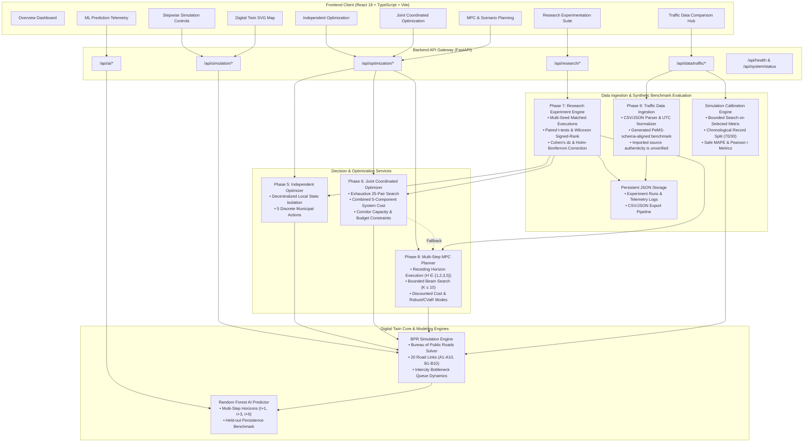
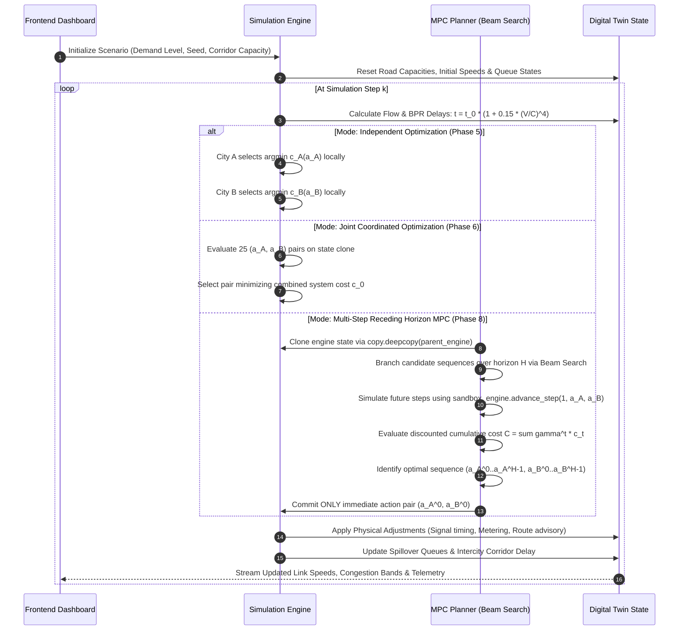
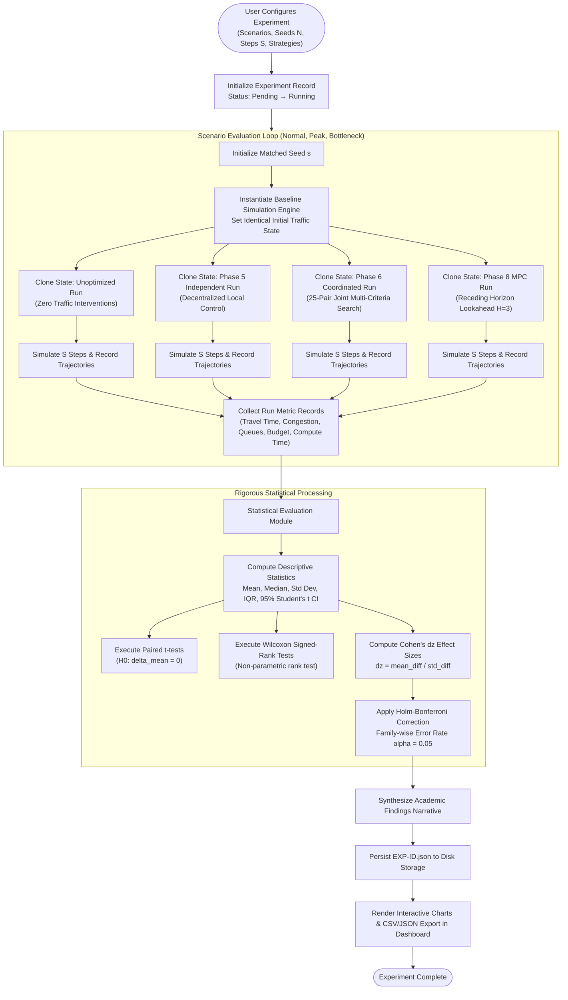

# AI-Driven Twin Cities Optimization: Architecture and Operational Workflows

This document details the system architecture, operational workflows, synthetic research experiments, and traffic-data comparison protocols for the **AI-Driven Twin Cities Optimization** research prototype.

All diagrams are rendered using standard Mermaid syntax.

---

## 1. System Architecture Diagram

The system is organized into modular layers: an interactive React 19 frontend client, a FastAPI high-throughput REST backend, a BPR-governed simulation digital twin, ML prediction and multi-strategy optimization engines, and a persistent research experiment data store.



---

## 2. Operational Workflow Diagram

Illustrates live simulation and multi-step receding-horizon Model Predictive Control (MPC). MPC evaluates candidate actions through cloned simulation-engine rollouts; it does not call the Random Forest predictor.



---

## 3. Research Experiment Workflow Diagram

Illustrates the simulation-based evaluation pipeline that compares strategies under matched initial seeds, calculates descriptive metrics, and runs paired inferential tests:



---

## 4. Traffic Data Comparison Workflow Diagram

Illustrates Phase 9 ingestion and comparison. The bundled benchmark is generated synthetic data; imported CSV/JSON source authenticity is not verified. Metrics describe agreement with the selected inputs, not real-world validation:

```mermaid
flowchart TD
    InputData["Traffic Data Input<br/>• User-provided CSV/JSON (unverified source)<br/>• Generated PeMS-schema-aligned synthetic benchmark"] --> ParseStage["Ingestion & Parsing<br/>• Detect Column Formats<br/>• Normalize Timestamps to ISO 8601 UTC"]

    ParseStage --> QualityCheck{"Data Quality & Hygiene Audit"}
    
    QualityCheck -->|Negative Flow, Speed > 220 km/h, Occupancy > 100%| Quarantine["Quarantine Buffer<br/>• Record Rejection Reason<br/>• Retain for Audit Log"]
    QualityCheck -->|Duplicate (timestamp, sensor_id)| Dedup["Drop Duplicates<br/>Increment Duplicate Count"]
    QualityCheck -->|Valid Input| ValidStore["Canonical Input Store<br/>Generated benchmark: SIMULATED<br/>Imported records: source unverified"]
    
    ValidStore --> MapStage["Detector-to-Road Mapping Layer<br/>• Map Sensor ID to Modeled Road (A1-A10, B1-B10, Corridor)<br/>• Confidence Tag: Exact / Spatial / Heuristic"]
    
    MapStage --> ChronoSplit["Chronological Train/Validation Split<br/>(Default: 70% Calibration, 30% Holdout)"]
    
    subgraph CalibrationModule["Model Calibration (70% Split)"]
        ChronoSplit -->|First 70% of Timestamp-Sorted Records| BoundedSearch["Bounded Grid Search<br/>• Demand Scale [0.5, 2.0]<br/>• Capacity Scale [0.7, 1.5]<br/>• Corridor Capacity Scale [0.5, 1.8]<br/>• Speed Factor Fixed at 1.0"]
        BoundedSearch --> SelectBest["Select Parameters Minimizing MAE<br/>for the Requested Metric"]
    end
    
    subgraph ValidationModule["Holdout Validation (30% Split)"]
        ChronoSplit -->|Last 30% of Records| HoldoutData["Synthetic Benchmark or Imported Records<br/>(source unverified)"]
        SelectBest --> SimCalib["Run Simulation with Calibrated Parameters"]
        HoldoutData --> CompareEngine["Input-to-Simulation Comparison"]
        SimCalib --> CompareEngine
        
        CompareEngine --> Metrics["Compute Error Metrics:<br/>• Mean Absolute Error (MAE)<br/>• Root Mean Squared Error (RMSE)<br/>• Safe MAPE (epsilon = 0.5)<br/>• Mean Signed Bias (over/under)<br/>• Pearson Correlation r (zero-variance safe)"]
    end
    
    Metrics --> ExportReport["Generate Validation Report<br/>• Compare Default vs. Calibrated Errors<br/>• Label Data Origins (OBSERVED, SIMULATED, CALIBRATED)<br/>• Export Processed CSV / JSON"]
    ExportReport --> EndVal(["Validation Complete"])
```
